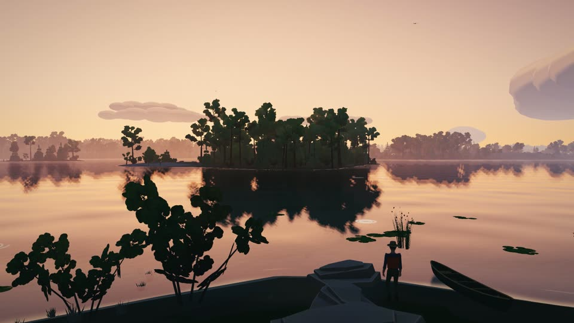

# BWCA Canoe

**Play it: https://gkrumbach07.github.io/bwca-canoe/** (a computer with a keyboard and mouse; about 20 MB
of map data streams in as you paddle).

**Watch the trailer:** [67 seconds, 720p, no sound](https://github.com/Gkrumbach07/bwca-canoe/releases/download/trailer-v2/bwca-trailer-v2-720p.mp4),
recorded frame by frame from the game ([`scripts/trailer/`](scripts/trailer/)).

[](https://github.com/Gkrumbach07/bwca-canoe/releases/download/trailer-v2/bwca-trailer-v2-720p.mp4)

A quiet canoeing game set on real terrain in the Boundary Waters Canoe Area Wilderness: the whole
wilderness, from Crane Lake to the Pigeon River, streamed in 2.56 km tiles as you paddle. You start at the
Lake One landing (entry point 30) east of Ely, Minnesota.

- **Real elevation**: USGS 3DEP / SRTM heights via the public AWS Terrain Tiles (Terrarium encoding).
- **Real lakes, portages, campsites and entry points**: OpenStreetMap, from an offline Geofabrik extract.
  Creeks that OSM maps only as lines are water too, and rivers descend between lakes.
- **Real depths** where the Minnesota DNR has mapped the lake: its bathymetric contours shape the bed
  (85 lakes in the Boundary Waters, Snowbank at 43 m, Loon at 64 m); the HUD shows the depth under the canoe.
- **Real clarity**: every lake carries its mean Secchi depth from the DNR's lake data (272 measured lakes in the
  area, from 0.6 m bog water to 8.9 m at Clearwater; the rest estimated from their neighbours). Clear lakes
  are blue-green and show the bed far out; tea-stained lakes go olive-brown and close up within a few metres.
  The bed itself is coloured by depth: sand, shelf, weed, drop-off, hole.
- **Everything else is procedural**: terrain colouring, lake beds, nine tree species with per-tree variation,
  shoreline boulders, campsites (fire grate, log, tent), portage trails and markers, the canoe, the paddler
  and the paddle stroke, the water, the sky and the clouds. No external assets.
- **Streamed world**: a 10 m grid of 200 x 69 km (138 million cells) is baked into 2,106 tiles; the game keeps
  the 5 x 5 tiles around the canoe built (terrain, water, forest, lake plants, trails) in a pool of web
  workers, a coarse 80 m far field underneath, and lets the rest go.
- **GPS simulation**: the canoe's real-world latitude/longitude is broadcast as the device location,
  so other tabs that ask for geolocation see you paddling (see *GPS simulator* below).
- **The pace** (`src/pace.js`): a game day covers a real BWCA day's distance. Everything moves at life pace (a solo
  canoe at a tripper's 5.8 km an hour in strokes of about 1.6 m, a 3 mph walk in steps of about 0.7 m, a portage carry
  at 3 km an hour), and while you travel the canoe and the clock are time-lapsed together: at **Trip** pace (the
  default; Settings › Controls › Pace) ×4 on open water, a game hour of paddling in about fifteen real minutes, and up
  to ×3 on a portage trail, so a travel day of 4 to 6 game hours covers 20 to 25 km. The canoe's boost builds once the
  stroke is steady and eases off on a slow stroke, in a hard turn and in the last few metres before a bank dead ahead,
  but not along a shore or into a dock. Camp, chores, fishing and walking off a trail stay at life with the clock at
  12×. **Real** pace is 1:1 throughout. A "trip ×4" mark sits bottom right while the boost carries you, and the
  readout (Tab) gives the clock's rate and the km an hour, averaged over a stroke or two. The game keeps to the wall
  clock at any frame rate (a slow frame runs as several steps), so 5.8 km an hour is 5.8 km an hour.
- **A day in the Boundary Waters**: a day/night cycle on the pace's clock with the real sun and moon for the date and
  the clock (`src/astro.js`: sunrise and sunset shift through the year, the moon shows its phase), a
  sky-matched haze, golden light at the ends of the day, the clouds, the water, stars, with dawn mist over
  the lakes. The game starts on today's date at the current time.
- **Seasons** (`src/season.js`, from the day of the year): the lakes are frozen until ice-out in early May and
  again from late November; birch and aspen leaf out pale green in mid-May, turn gold in the last half of
  September and drop by the end of October, shrubs go red; grass goes tawny in the fall; lily pads are on the
  water from June to late September, fireweed blooms in high summer, loons are on the lakes from May to
  October, and cold mornings bring heavier mist. `day.season` carries all of it for anything else to use. Lakes are clear in the shallows
  (lily pads, reeds and weeds grow in sheltered water) and tannin-dark in the deep. Loons drift, dive and
  call; wind, lapping water and paddle dips are synthesized, no samples.
- **The look** (`docs/look.md`, after Firewatch): the ground is a painted splat of eight materials blended
  through world-space noise, so transitions are soft bands and never polygon edges; one smooth light model
  for everything (`src/shading.js`: Lambert, wrapped on the leaves, the sky as a hemisphere fill, soft
  stable shadows), with occlusion baked into every tree, rock and hull; grass tufts and fireweed near the camera.

## Run

```bash
npm install
npm run bake:all
npm run dev
```

Open http://localhost:5173. The game opens on a title screen over the live lake: **Continue** (or **Paddle in**
before any season) picks up the season saved in this browser (or starts one at Lake One), **New season** starts
one at any BWCA entry point, **Settings**
has the quality, sound and control options (applied live, kept in `localStorage`). **Esc** brings the
same screen up as a pause menu while playing. The baked map data lives in `public/data/` and is not committed (about 380 MB
of tiles); the first bake downloads the Minnesota OpenStreetMap extract (290 MB) and about 5,800 elevation
tiles (500 MB) into `data-cache/`, then bakes the whole wilderness in about a minute (3 GB of RAM). Re-bakes
use the cache and finish in the same minute. For a quick test bake of the Lake One area only:

```bash
npm run bake
```

Other areas: `node scripts/bake.mjs --bbox S,W,N,E` (degrees). The areas and the grid/tile layout are in
`scripts/config.mjs`. If `osmium` is installed the extract is cut to the area first (seconds); without it the
extract is scanned in Node (about 15 s). The bake needs network access to `download.geofabrik.de` and
`s3.amazonaws.com/elevation-tiles-prod` the first time.

## Controls

The HUD is quiet by default: the screen belongs to the lake, and nothing is drawn until it has something
to say. Two materials: *Air* (cream type set straight on the scene: the compass top right, one action line
bottom centre, the place title and the journal lines bottom left, the status marks bottom right at half
strength) and *Paper* (cream sheets you take out and put back: the map, the journal, the outfitter's
counter, one at a time on a scrim). The numbers live behind held keys.

| Key | Action |
|---|---|
| W / S | paddle forward / back; on land, walk into the view / toward it |
| A / D | afloat: turn the hull while held, as sweep strokes, in both views. On land: strafe left / right |
| Shift | hustle (on foot, a jog: a longer stride with both feet off the ground between steps) |
| Space | afloat: brace (steadies the hull in a sea; you cannot paddle while bracing). The balance arc appears above the action line while the sea is working the hull. On foot: hop, about 0.4 m, onto a low rock or a log or over it (with the canoe on your shoulders you only stagger) |
| E | go ashore when the canoe is close to a bank; portage when near a landing; at an outfitter's dock, tie up and go in (you stand at the store's door; inside the view is first person); in the store, E at the counter, the cork board, a shelf or the lure wall opens the counter at that tab, and E or Esc puts it away; in a store, talk to someone you face (the keeper away from the counter, or a visitor: their word names a real lake, fish, site or carry; a second E takes on their one task, paid by them or at that counter); pick up a found item; on foot at the water's edge, fill the bottle (a tablet: drinkable in half an hour); on foot, launch a canoe lying at the water's edge, launch a carried canoe at a shore with water enough, or set it down. On a double portage: set the canoe down at the far end, pick up the pack left at the trail head, load up and launch. At a campsite: pitch the tent, gather firewood (an armful in 25 minutes, 10 with the saw; three at most, stacked by the ring), light and feed the fire, cook, use the latrine, pick blueberries in season (July 10 to August 20, on the burns and the lichen rock by some sites), fill the bottle, and at the tent sleep (see [docs/trip-core.md](docs/trip-core.md) and [docs/hubs.md](docs/hubs.md)) |
| Q | the second choice at a shore: at an outfitter's dock, the counter straight from the water; at a store's counter, a word with the keeper (the first of the day raises your standing there a little); go ashore at a portage landing without portaging, leave a beached canoe where it is, shoulder a canoe on the ground, set a carried one down where you could launch it. On a portage: take the gear pack too (one heavy trip), or fetch the pack left at the trail head (a short fade while the walk back and the second carry pass) |
| ← / → | standing still at your tent in the evening: the wake-time card (first light, 7:00 or 9:00), ← → to choose, E turns in, Esc lets it be |
| C | the camera, when you have one (the $25 35 mm from an outfitter's gear shelf, or the disposable the season's first photo notice lends you for three pictures): the view goes to the eye in the print's 16:9 frame; the mouse (or the arrows and WASD, Shift for a fine hand) aims, the wheel (or Q and E held) zooms from a 50 mm to a 300 mm lens, Space or a click takes the picture, C or Esc lowers it. You hold still while it is up, and the clock runs at life's pace. A subject counts when it is near the middle of the print, near enough and in sight; the prints are kept in the journal's Photos tab |
| Tab | hold for the readout: where, water, way, wind, light, the permit and the money, energy (what holds it down, the hours up, the bottle), pack, tasks (Settings › HUD can make it a toggle, or keep it up; Developer adds the GPS sim, tiles, FPS and triangles) |
| M | hold for a glance at the map (a half-sheet, 5 km across, slides up from the bottom right); press for the full sheet: drag to pan, wheel to zoom, click a spot and a pencil note says the way there (in Sandbox it asks before the canoe is moved); the header toggles the layers; M or Esc puts it away. In Adventure the campsites, portages and soundings show on the map sheets you own and near where you have been; a keeper's insider word is a pencilled ring |
| J | the journal: the trip (food, energy, kilometres, portages, lakes, nights, notices on the go) on the left page, the tabs Catches / Tasks / Lakes / Trips / Gear on the right. L opens it too, for a while |
| F | take up the fishing rod / put it down (see *Fishing*) |
| G | eat a meal (when you are still: in the canoe or on foot) |
| H | the headlamp, afloat or on foot (it goes off on its own in full daylight and when you sleep) |
| Space / mouse button | with the rod up: hold to load a cast where the reticle sits on the water and let go; set the hook on a bite; hold to reel in a fight |
| 1 – 7 | with the rod up: jig & twister, Mepps spinner, Daredevle spoon, jointed Rapala, bobber & leech, Silver Minnow, Lazy Ike (the strip above the action line; the ones not in your tackle box are faint and refused, and a snapped line loses that lure) |
| K / E | keep the landed fish (on the stringer, or in a notice's cooler when one taken on wants it: the prompt says which) / let it go (the catch card bottom left carries the fish) |
| V | switch between first-person and chase camera |
| [ / ] | step the time of day back / forward an hour (Sandbox) |
| - / = | step the date back / forward a day (with Shift, a month) (Sandbox) |
| P | pause the clock (a mark bottom right says so) (Sandbox) |
| N | mute / unmute the synthesized soundscape |
| , / . | less / more wind (Sandbox; `;` hands control back to the weather) |
| / | veer the wind 30° (Sandbox) |
| R | toggle the shore, its trees and the canoe mirrored in the water (a second scene pass; off, the water mirrors the sky alone) |
| 1 / 2 / 3 | game speed 1× / 2× / 4×, on top of the pace (a ×2 mark bottom right while it is up) |
| Esc | frees the mouse when the look has taken it; otherwise pause: the title screen with Paddle on / New season / Settings / Controls (Esc again, or Enter, resumes); Controls shows this table in the game |
| mouse | look. In first person, and on land in third person, the mouse turns you the way it does in Minecraft: the first key or click takes the mouse, every movement turns the look at once, Esc frees the mouse (Esc again opens the menu). On land the body faces the look and WASD moves relative to it, A and D strafing; in third person the camera sits behind you and the mouse's tilt swings it up or down. Behind the canoe the cursor stays free: drag to orbit, wheel to zoom. *Settings → Steer the canoe where you point*: while you hold W the bow turns toward the cursor's point on the water, or toward the look in first person; A/D nudge, and nothing sticks |
| the map sheet | click a spot to paddle in there (teleport to the nearest open water, anywhere in the wilderness; Sandbox). In Adventure the note gives the distance, the hours by the clock and, where your map shows them, the portages |
| the title's entry points | the list beside *New season* starts a season with its home at one of the BWCA entry point landings, travelling the way picked above it: *Adventure* (open trips: food to buy, notices to take, real rules) or *Sandbox* (no limits); you begin tied up at the home store's door; over a season under way, pick it twice |

What the HUD says on its own: the compass sits at the top right at half strength, its gold arrow on the rim
where the wind is going, and speaks (full strength, the Beaufort name, the speed, the waves) when the wind
matters: a fresh breeze and up, or waves over 0.3 m. Arriving on a named lake puts its name up bottom left for
four seconds with the day, the hour and the wind over it and the portages, kilometres and the lake's size
under it; dawn puts the day up the same way. Notes (a meal, a find, a word from the outfitter) are journal
lines bottom left, two at most, five seconds each. *Settings › HUD* has the density (Quiet: prompts and the
balance arc only, the compass only when the wind matters; Standard; Full: the readout always on and a corner
sheet of the map), and switches for the place titles, the compass, the readout, the corner sheet, the journal
lines, the key hints, the HUD size and colour-blind marks.

Paddle up to any bank and press **E**: the canoe noses in, you step out, and you choose to **E** shoulder
it or **Q** leave it beached there, bow on the land. On foot WASD walks relative to the view (W into the
screen, D to its right; with the mouse look the body faces the look and the walker strides, backs up or side-steps
as the keys say), at life pace: 1.35 m/s (a jog at 2.9 with Shift; with the canoe on your shoulders about 0.85,
3 km an hour, by the load). On a portage trail the walk is time-lapsed with the clock at Trip pace (seen at about
2.5 m/s under the canoe, up to ×3). The woods walk at the same pace as a trail; only the hills cost, less on a graded trail,
and a slope past 40° stops you. Trunks and walls hold you off and you slide round them, and water past
your knees stops you. A rock stops you at its edge, as it is drawn; one lower than a step (a slab, a small
rock, a log on its side) you step up onto, and **Space** hops about 0.4 m, onto a higher one or over a log. The readout's km/h is the ground you actually make good per hour of the game's clock, so it falls to nothing while
something holds you. A canoe you have left
shows on the map; back within 3 m of it, **E** launches it (**Q** shoulders it instead), and if the water
there is too shallow for a canoe the prompt says so. Carrying, **E** launches at any shore with a metre of
water within reach, or sets the canoe down where there is none, and the hull overhead catches on trees
and may come down. Walk into a campsite and the readout names it.

At a portage landing (the trail marker on shore) **E** instead takes the canoe to the trailhead and
shoulders it, and the action line counts the rods to go along the real trail; **Q** goes ashore there without
portaging. Portage lengths are shown in rods, as on every BWCA map.

The title and pause screens are keyboard-first: the arrows move between items (← → between the menu and the
entry points), Enter picks, Esc goes back. Settings (`src/settings.js`) come in sections: Display (shadow map
size, tree detail and cull distance, render scale, the shore and sky in the water), Sound (volume, mute),
Controls (mouse sensitivity, inverted look, cursor steering, the pace, the game speed and camera a trip starts with),
HUD (above) and Developer (the GPS simulator's state, FPS and triangles and the tiles as rows of the readout).
The canoe's position, heading, the day clock and the camera mode are saved every few seconds
(`src/save.js`, one `localStorage` document per namespace under `bwca-canoe:`; the journal's trip tally
is `stats`, the HUD settings `settings`) so **Continue** picks the trip up where it stopped.

## Wind and waves

Every day has its own wind (`src/wind.js`): a character rolled at midnight from glassy to a blow, a breeze that
builds through the afternoon and dies at dusk, gusts, and a direction that veers slowly. Waves are built from
it (`src/waves.js`): eight fixed wave directions each carry a 26 m swell and a 6.5 m chop, the wind sets how much
each direction carries and how tall the waves are from the wind speed and the **fetch**, the open water upwind
of each spot (marched across the water's surface atlas whenever the wind moves to a new 15° bucket). So a
small lake stays flat in a gale while the downwind shore of a big one builds whitecaps. The canoe drifts
downwind and its bow falls off the wind. Broadside to real waves the hull rolls; quarter the waves or hold
**Space** to brace, or over you go: the hull floats upside down, drifting, and you swim to it (W/S, A/D) and
press **E** to right it and climb back in. On a calm day the canoe cannot be tipped.

## Fishing

Fishing is the thing to do out here (`src/fishing.js`). Press **F** in the canoe and the paddle goes across the
gunwales and the rod comes up; the line under the readout says what kind of water you are sitting in
("Rocky point · 4 m, drop-off to 9 m · walleye and smallmouth water", "Weedy bay · 1.8 m · pike water"), read
from the real bed, the shore distance, the weed beds and the bedrock shores around the canoe. Pick a lure with
**1–7** (jig, spinner, spoon, crankbait, a leech 2.4 m under a bobber, the weedless Silver Minnow or the Lazy Ike;
the ones in your tackle box, bought on an outfitter's lure wall), hold **Space** or the mouse button
to load the cast and let go: the lure flies to where the cursor points (in first person the view itself follows
the cursor); a pale ring on the water marks the spot, a full load drops the lure on it and a short one falls short. It
splashes down and sinks at its own rate, or the bobber rides the swell. **W** retrieves (Shift faster;
a crankbait dives, a spinner runs shallow, a jig hops along the bottom, the leech is best left alone), and you
can change lures again once it is back at the rod.

Fish bite at a rate built from where the lure is, not from a timer: walleye on rocky points and drop-offs in
3–11 m at dawn, dusk and night, by day more willing in tea-stained water and in a light chop; smallmouth off
bedrock shores in clear water; northern pike in weedy bays; crappie and perch in the weeds; lake trout only
deep, in lakes the DNR maps deeper than 20 m. The lure's depth, its action, the hour, the lake's Secchi depth
and the wind all go in, and every factor is in the open (`window.__game.fishing.factors`, `TUNING`, `SPECIES`,
`LURES`) for tuning. A bite is the bobber going down or the rod tip tapping with a short plop: press
**Space** inside the window to set the hook. Then the tension bar: hold to reel (tension up, line in), let go
when the fish runs (tension down, line out). A fish's runs come in pulses and weaken as it tires; bigger fish
pull harder and longer. Red for too long parts the line and the fish keeps the lure (another is tied on, no
other penalty); slack for too long and it throws the hook. A landed fish is held up for a look (the camera comes round to the paddler's front for it), with its
length and weight on a paper catch card bottom left, and **K** keeps it (it hangs on a stringer over the
port gunwale) or **E** lets it go. The catch log lives in the journal (**J**, Catches tab): species, length,
weight, lake, time and lure for every fish, with personal bests, kept in the browser between sessions. While
the rod is up the spot card top left reads the water (the bed, the depth, the clarity, who lives there), the
reticle sits where the cast will land and fills as the cast loads, and the lure strip sits above the action
line.

The map is drawn as a paper topographic sheet in the spirit of the Fisher and McKenzie maps: hypsometric
tints, 10 m contours, pale-blue lakes with depth contours and figures where the DNR has sounded the lake
(every 2 m to 10 m, then every 5 m and 10 m), red dashed portages with rod counts, red campsite dots and
serif lake names. It is a window around the canoe: loaded tiles are drawn from their own cells, the 80 m far
field fills in beyond them. `M` opens it wide.

## Trips and tasks

A season travels one of two ways, picked on the title card: **Adventure** (open trips from push-off until you call
it at a counter, food bought with money, one energy bar pulled down by rest, food and water, camping at the designated
sites only, a calm evacuation when the bar runs empty) or **Sandbox** (the same lakes
with no limits). A new season starts at the entry point you pick, home, with $40 and the starting kit. The trip core is
described in [docs/trip-core.md](docs/trip-core.md), and the outfitter hubs it is growing into in
[docs/hubs.md](docs/hubs.md) (the owner's own words are in [docs/game-vision.md](docs/game-vision.md)).

Every BWCA entry point landing has an outfitter: a dock and a board-and-batten store you walk into, with the name over
the door (the Ely, Sawbill and Gunflint outfitters where they are well known, plausible ones elsewhere; the list is in
`src/outfitter.js`). Each is its own (`src/outfitters.js`): a lodge, a river post, a trout camp or a bait shop, with a
keeper (fictional) who has a manner, lines for the moment and insider hints read from the real lakes, prices of its
own, a signature item sold only there, and a board that leans its own way. At the dock **E** ties up and you walk in
(first person inside); **Q** opens the counter from the water. **E** at a hotspot opens the counter (Paper) at a tab:

- **The counter.** The season permit, stamped at the first counter; food at about $6 a day (two meals, 0.9 kg), up to
  what the packs hold; the counter's tap fills the bottle. During a trip, **Resupply · carry on** keeps it going and
  **Call it a trip** logs it as came in, with a bunk night. The keeper's word, the map sheets of this country ($8,
  `src/sheets.js`), a bunk tonight ($8), the rides up the road (`src/rides.js`: to the outfitters you know and the next
  one you don't, about $5 + $0.50 a km, the canoe on the roof), and your kit, the season's earnings and your standing.
- **The board.** Four notices on the cork board by the door (`src/tasks.js`): fish for the café (a kept fish that fits
  goes into the notice's cooler), a lost item at a campsite (E picks it up), a portage to survey. Clues are written from
  the real map. Each pays money, claimed only at the counter that posted it; one notice changes each morning, and
  nothing taken on expires.
- **The shelves and the lure wall** (`src/shop.js`): food and water, tackle, gear. A better paddle, a lighter or
  steadier canoe, a second pack (and the double portage), tents, filters, a rod, lures; each says what it does in the
  keeper's words, and is felt rather than counted (the Kevlar and a bent-shaft paddle make the canoe about 9 % quicker
  and 14 kg lighter on the portages).

You know only your home outfitter at first; reaching another landing, or a ride up the road, makes it known. The big
map (**M**) shows each notice on the go as a soft circle around its lake, never the spot, and the water a keeper has
told you about as a pencilled ring. The season (`bwca-canoe:profile`), the map you have seen (`bwca-canoe:sheets`) and
the trip (`bwca-canoe-trip`) are kept in `localStorage` and resume where you left them, on the store's floor too.

## Data pipeline

`npm run bake:all` runs `scripts/bake.mjs --all`:

1. **OpenStreetMap** (`scripts/osm-extract.mjs`, `scripts/osmpbf.mjs`): downloads the Geofabrik Minnesota
   extract once, cuts it to the area (osmium when available), and reads water polygons (`natural=water`,
   riverbanks, reservoirs; multipolygon relations are stitched), portage ways (`portage=*`, `canoe=portage`,
   `highway=portage`), campsites (`tourism=camp_site`) and landing points of interest with a dependency-free
   PBF reader. The result is cached as JSON per area.
2. **Elevation** (`scripts/elevation.mjs`): Terrarium z14 tiles for the area are cached and sampled
   bilinearly, row by row.
3. **One global 10 m grid** in a local metres projection with a single origin at the area centre (x east,
   z south; the ~1 % scale drift over 70 km of latitude is accepted). The grid is padded to whole tiles.
4. **Bands with a halo**: elevation sampling, the exact Euclidean distance transform to the shoreline
   (clamped at 3 km) and the shore smoothing run in 1024-row bands with a 320-row halo wider than the clamp,
   so every value equals a whole-grid computation and nothing changes across band or tile edges.
5. **Basins, levels, names** on the full grid: connected lake water shares one level (a low percentile of
   its interior DEM heights, robust to shoreline trees). Rivers and creeks get a **per-cell level** instead:
   a monotone non-increasing profile is fitted along each OSM waterway line (a running low percentile of the
   DEM, then pool-adjacent-violators, anchored to the lakes the line passes through and reversed when the
   DEM says the way was drawn upstream), then spread across the river's width. Creeks that OSM maps only as
   lines are rasterized as channels about two cells wide so they exist as water. Unnamed channels and bays
   take the name of the nearest named lake reachable by water (one multi-source flood fill).
6. **Depth** (`scripts/bathymetry.mjs`): the DNR *Lake Bathymetric Contours* for the area are fetched once
   through the Geospatial Commons REST service and cached. Each contour line is rasterized as a known depth,
   the first ring of water cells is pinned at zero, every cell starts from its nearest known depth and sixty
   Gauss-Seidel sweeps relax the rest into a smooth bed. Lakes without a DNR map keep a synthetic bed that
   drops at about 9 % from the shore, capped at 14 m.
7. **Clarity** (`scripts/clarity.mjs`): the DNR *Lakes of Phosphorus Sensitivity* polygons (mean Secchi depth
   and total phosphorus) and the *Watershed Health* lake scores (mean water clarity) are fetched for the area and
   cached; each DNR polygon is sampled on a lattice and its reading goes to the OSM polygons it covers. Lakes
   without a reading take a distance-weighted mean of measured lakes within 15 km. The lake table carries
   `secchi` (and `secchiMeasured`); the runtime hands it to the water shader per vertex and through the atlas.
8. **Shore shaping**: lake beds are carved below their level and shoreline land is lifted above it, in
   bands again, then the tiles are cut.
9. **Output** in `public/data/`:
   - `index.json`: grid and projection, per-tile flags (has water, height range), the lake table (names,
     display names, levels, centroids), basins, every portage (polyline, rods, launch points), campsites,
     entry points and the start position.
   - `tiles/{tx}_{ty}.bin`: gzip of `[height Int16 dm][lake id Uint16][shore distance Int16 dm][water level Int16 dm]` for
     268 x 268 cells: the 256-cell tile plus a 6-cell halo on every side, so a tile can be built (terrain,
     forest, props) from its own bytes alone, and shared edge vertices come out bit-identical on both sides.
   - `far/{fx}_{fy}.bin`: the same layout on an 80 m grid (block means; the deepest cell decides the lake id)
     in 256-cell far tiles for the far field.
   - `overview.png`: an 80 m/px shaded map of the whole area.

Entry points come from OSM features named `… BWCA Entry Point` where they exist, otherwise from the hand
list in `scripts/entrypoints.json` (number, name, the OSM lake name and an approximate position); edit that
file to add or correct landings.

## Runtime

- `src/world.js` loads `index.json` and answers every spatial query (`heightAt`, `shoreAt`, `lakeIdAt`,
  `levelAt`) through the loaded tiles, falling back to the far field and then to flat ground.
- `src/tiles.js` (`TileManager`) keeps the 5 x 5 tiles around the canoe and 3 x 3 far tiles loaded. A pool of
  workers (`src/tile-worker.js`) fetches and gunzips a tile, places the forest, the lake vegetation and the
  ground-cover map deterministically from the global cell coordinates (`src/placement.js`), builds the
  terrain (`src/terrain-build.js`) and the water mesh (`src/water-build.js`) as transferable typed arrays;
  the main thread wraps them into meshes, one tile per frame, and builds the tile's trails and campsites
  (`src/props.js`). Tiles outside the neighbourhood are dropped least-recently-wanted first; far chunks
  stand in wherever a fine tile is missing.
- **Floating origin**: every tile's geometry and instance matrices are local to the tile corner, and the
  water shaders work relative to the corner of the player's tile. All wave frequencies are rounded to whole
  periods per 2,560 m (`src/waves.js`), so the origin can jump by a tile without the swell changing phase.
- **The surface atlas**: the water keeps a sliding 256-cell atlas of shore distance, water level, terrain
  height and ground cover around the canoe (`src/water.js`). The same GLSL (`glslSurface`) gives every
  shader the terrain surface and the swell exactly as the water patch renders it: lily pads, reeds, foam
  bubbles and loons ride it (`src/floating.js`, `src/wake.js`), grass stands on it (`src/groundcover.js`),
  the mist is masked by it (`src/mist.js`).
- The day/night cycle (`src/daycycle.js`) drives the lights, the sky dome, the clouds, the water colours, the
  stars, the mist and the colour grade (`src/post.js`); the haze is matched to the sky by overriding three's
  fog chunks (`src/fog.js`).

## GPS simulator

A web page cannot change what other tabs see from `navigator.geolocation`, so the game ships with a small
companion extension in `extension/` that does it:

1. Open `chrome://extensions`, turn on *Developer mode*, choose *Load unpacked* and pick the `extension/`
   folder.
2. Keep the game tab open. The extension receives every position fix the game publishes and overrides
   `navigator.geolocation.getCurrentPosition` / `watchPosition` in every other tab.
3. Click the extension's toolbar icon to switch the simulation on or off.

The game also publishes the fix on a `BroadcastChannel` named `bwca-canoe-geo` and in `localStorage`
(`bwca-canoe-geo`) for same-origin pages, and overrides `navigator.geolocation` on its own page.

## Lake depth and clarity

Lakes with a DNR bathymetric map have their real bed (see *Data pipeline*); the rest are carved from the
shoreline (about 9 % grade, capped at 14 m). Every lake still uses the same clarity (`uClarity`, 3 m, a
typical Secchi depth for these tannin-stained lakes); Secchi readings per lake from the DNR LakeFinder /
MPCA lake water quality pages could replace it.

Known limits: river surfaces follow the DEM profile, so a rapid shows as a steady drop rather than a step;
creeks are two cells (20 m) wide because of the 10 m grid; the Canadian side of the border lakes is only as
complete as the Minnesota extract makes it (add `north-america/canada/ontario` to `CFG.extracts` in
`scripts/config.mjs` for the Quetico shore).

## Hosting

The app is a static build (`npm run build` → `dist/`) and the data is fetched on demand from wherever
`VITE_DATA_URL` points (default: `data/` next to the app, which is `public/data` in development). The
recommended setup, with costs, is in [docs/HOSTING.md](docs/HOSTING.md): the app on GitHub Pages
(`.github/workflows/pages.yml` deploys it on every push to `main`), the 380 MB tile set in a Cloudflare R2
bucket behind the CDN (S3 + CloudFront as the alternative), uploaded with `npm run data:sync`. A Lake One
bake (`npm run bake`, about 4 MB) can ship inside the app instead for a demo. `.env.example` lists the
variables.

## Layout

```
scripts/        bake pipeline (config, OSM extract, elevation, DNR bathymetry, bake) and data-sync.mjs
src/            the game (three.js, ES modules; tile-worker.js runs in web workers)
                title.js / settings.js / save.js: the title and pause screen, settings, saved trips
extension/      the GPS simulator Chrome extension (MV3)
docs/           screenshots and HOSTING.md
.github/        the GitHub Pages workflow
public/data/    baked tiles, not committed
```

Map data © OpenStreetMap contributors (ODbL). Elevation: USGS 3DEP / NASA SRTM via Mapzen/AWS Terrain Tiles.
Lake depths: Minnesota DNR Lake Bathymetric Contours; clarity: Minnesota DNR lake phosphorus sensitivity and
watershed health data, all via the Minnesota Geospatial Commons.
