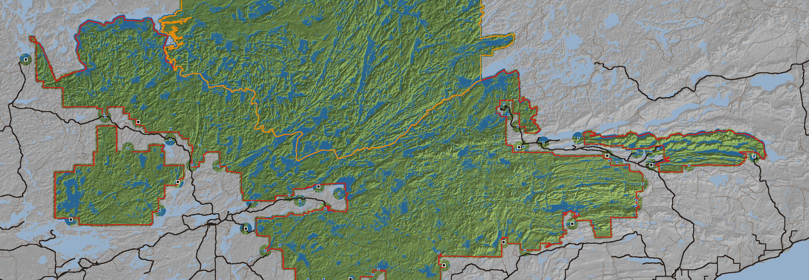

# The edge of the world, and the roads

A proposal for the owner's question of 2026-11-05: *"do we still plan on adding the roads and the boundaries of where
you can't go? … technically right now you could walk all the way to Lake Superior … we decided that we're not going
to build out the cities and towns. So for the non-BWC area, how do we deal with that?"*

Read-only on the code (origin/main cccfed5). Figures come from the v9 release (`public-data-v9/index.json`), the
Forest Service boundary the map already draws (`src/boundary.bin`), Quetico's outline and the roads from the cached
OpenStreetMap extracts (`data-cache/osm-2026-11-01`, Geofabrik, 2026-10-25). The map below is `edge-and-roads.png`.

*Red: the BWCAW boundary. Orange: Quetico. Green: inside the proposed edge (the wilderness plus 400 m, plus 1.5 km
round each entry point). Grey: outside it, with its water pale blue (Lake Superior in the bottom-right corner). Black
lines: the real highways and county roads (OSM trunk to tertiary); brown: the smaller roads. Black squares: the 14
outfitters. Blue squares: the 41 trailheads.*

---

## For the owner, in plain words

**What's out there today.** The baked world is a 200 × 69 km box. Only about half of it is wilderness: the Boundary
Waters is 32 % of it (4,400 km²) and Quetico another 16 % (2,250 km², its southern half; the box's north edge, 48.40° N,
cuts Quetico through the middle). The other 52 % (7,100 km²) is just more of the same forest and lakes: Lake Vermilion,
Burntside, White Iron, Birch, Gunflint, the Canadian side east of Quetico, Voyageurs' Sand Point and Namakan in the
north-west, and 112 km² of Lake Superior in the south-east corner. Nothing marks any of it as different. There are no
towns (Ely, Winton, Tower, Crane Lake village, Hovland, the Lac La Croix village are all bare forest where they
stand), no highways and no roads in 3D at all: the roads exist only as a hidden graph that prices the truck. Nothing
stops you: you can walk from the Arrowhead Trail down to Superior's shore (about 20 km), and past the box's edge the
ground runs on with nothing drawn under you.

**What we recommend.** A soft edge plus short roads, as one design:

1. **The playable land is the wilderness and its doorsteps.** The BWCAW and Quetico, 400 m round them, the whole of
   the water you use to get in (Moose Lake, Saganaga, Gunflint, Crane Lake…), and a small patch round every entry
   point's lot. That keeps 52 % of the box; everything you can do today you can still do.
2. **Past it you're turned back gently, never by a wall.** You slow over the last few metres and stop; the canoe turns
   back toward the wilderness. One plain line the first time, short after: *"Cabins and motorboats from here on. The
   wilderness is behind you."* / *"That's the road to town. The truck's the way out."* / *"Past here is off your
   maps."*
3. **The view doesn't change.** The land past the edge stays drawn to the horizon exactly as now. You just can't go
   there. Superior and the towns are never reachable and never need building.
4. **The last stretch of the real road into each lot is drawn**: a gravel or blacktop ribbon from the lot out to the
   edge and a little past it, into the trees, where the truck comes and goes. The rest of the road network stays the
   hidden graph it is now.
5. **The map's paper fades past the edge**, the edge drawn as a pencil line beside the boundary's dash-dot the map
   already has.
6. **Quetico**: until Quetico permits exist, the border is part of the edge (you can paddle the border lakes, not land
   on the Canadian side). When Quetico permits ship, that piece of the edge opens for whoever holds one.

**What it costs.** One build round: three streams (the edge and its stop; the map; the roads in 3D with the truck)
and a join, about **750 M tokens, 2–3 hours**. The edge alone, without drawn roads, is two streams and a join, about
**490 M tokens, ~2 hours**. No new data release is needed: the edge and the roads are small tables in `src/` like
the boundary is today. Frame cost is nil for the edge (one lookup a frame) and no new draw calls for the roads (they go
into each tile's own ground decal, as the trailhead lots and portages do).

**The calls we need from you** are listed at the end (the edge's width, Quetico before its permits, a few outlier
entry points, whether you may walk the road between lots that sit close together).

---

## What's there today, measured

### The box and the wilderness

| | km² | share of the box |
|---|---:|---:|
| The baked world (x −99.8…+99.8 km, z −34.6…+34.6 km; 47.78–48.40° N, 92.55–89.88° W) | 13,800 | 100 % |
| BWCAW (3 pieces: the main body, the Trout Lake piece, the Gunflint/Arrowhead strip) | 4,410 | 32 % |
| Quetico, inside the box (about 47 % of the park; its north half is off the box) | 2,250 | 16 % |
| Neither | 7,070 | 52 % |
| Wilderness + 400 m | 6,970 | 50 % |
| Wilderness + 400 m + 1.5 km round each entry point (the green on the map) | 7,150 | 52 % |
| Wilderness + 1 km / + 2 km | 7,380 / 8,020 | 53 / 58 % |

The box's edges against the wilderness: west 7.4 km past the BWCAW, east 10.6 km, north 3.9 km past the BWCAW but
**inside Quetico** (the north edge cuts Quetico's lakes: 40-odd water crossings, the widest 2.5 km in Namakan/Sand
Point), and south: **the BWCAW pokes 755 m past the box's south edge** near Isabella (x −27…+9 km). Water also runs off
the south and east edges in Superior (23 km and 10 km of it).

Data outside the wilderness today: 192 of the 2,250 campsites (78 of them more than 5 km out: Lake Vermilion 12, Sand
Point 11, Burntside 7, Lake Jeanette 7, Gunflint 6, Crane Lake 5, Superior 4…), 145 of the 1,295 portages, and every
town on the road graph. Quetico holds 345 portages and no campsites (it has no designated sites; that is right).

Past the box: `world.tileOf` clamps to the edge tile, so the walker reads the edge's ground on past it while no mesh
is drawn (read from the code, not played). Nothing in `player.js` or `canoe.js` limits where you go.

### Every entry point against the boundary and the roads

Distances are straight lines from the entry point's put-in (index.json `entryPoints`, the spot the lot and dock are
built beside: the trailhead lot sits within ~40 m of it, `props.js trailheadPlan`). *Out* = outside the BWCAW by that
much, *in* = inside. *Road* = how far the nearest drivable OSM way is from the put-in, and the stretch from there to
the named county road or highway.

**The 14 outfitters**

| EP | Place | vs the BWCAW | Nearest road | Last stretch to the main road | Note |
|---:|---|---|---:|---|---|
| 1 | Trout Lake | out 0.4 km | **4.3 km** | track → Hoodoo Point Rd, ~10 km | **outlier**: no road near; real access is by boat across Lake Vermilion |
| 6 | Slim Lake | out 0.2 km | 0.5 km | North Arm Rd → Echo Trail, 3.9 km | |
| 12 | Little Vermilion | **out 2.7 km** | 0 | Handberg Rd → Crane Lake Rd, 2.6 km | **outlier**: Crane Lake village, Voyageurs, 6.3 km from the box's west edge |
| 16 | Moose River North | **in 0.6 km** | 0.7 km | FR 206 → Echo Trail, 1.8 km | the store stands inside the wilderness |
| 25 | Moose Lake | out 0.5 km | 0 | Moose Lake Rd → Fernberg, 4.1 km | Moose Lake itself is outside |
| 31 | Farm Lake | **out 2.6 km** | 0 | Farm Lake Access Rd → Kawishiwi Trail, 0.4 km | **outlier**: the Kawishiwi out to White Iron and Ely |
| 36 | Hog Creek | out 0.1 km | 0 | Kawishiwi Lake Rd → Cramer Rd, 3.2 km | 3.7 km from the box's south edge |
| 38 | Sawbill Lake | out 0.3 km | 0 | Sawbill Trail (gravel), 7.8 km | |
| 40 | Homer Lake | out 1.1 km | 0 | Brule Lake Rd → The Grade, 6.4 km | |
| 49 | Skipper and Portage | out 0.7 km | 0 | Old Gunflint Trail, 1.2 km | |
| 51 | Missing Link | out 1.2 km | 0 | FR 1495 → Round Lake Rd, 1.2 km | |
| 64 | East Bearskin | out 1.1 km | 0 | East Bearskin Rd, 0.7 km | |
| 67 | Bog Lake | **in 1.0 km** | **1.5 km** | FR 381 → Tomahawk Rd → Hwy 1, 22 km | **outlier**: 255 m from the box's south edge; the store inside the wilderness |
| 69 | John Lake | out 0.9 km | 0 | Arrowhead Trail, 0 | 68, 69, 70 share one landing area |

**The 41 trailheads** (the outliers; the rest sit within ~0.5 km of the line and ~0.2 km of a road)

| EP | Place | vs the BWCAW | Nearest road | Why it's an outlier |
|---:|---|---|---:|---|
| 57 | Magnetic Lake | out 2.4 km | 0 | in via Gunflint Lake (border water, both shores outside) |
| 29 | North Kawishiwi River | out 2.1 km | 0 | river put-in at Ojibway Lake Rd |
| 7 | Big Lake | out 1.8 km | 0 | Big Lake is outside |
| 27 | Snowbank Lake | out 1.6 km | 0 | Snowbank is half outside, cabins on its south shore |
| 58 | South Lake | out 1.4 km | **2.0 km** | in by water from the Gunflint side |
| 50 | Cross Bay | out 1.4 km | 0.1 km | |
| 8 | Moose River South | out 1.3 km | 0 | |
| 20 | Angleworm Lake | in 1.8 km | **2.9 km** | a real 2-mile walk-in trail from the Echo Trail |
| 4 | Crab Lake | out 0.4 km | **2.3 km** | in from Burntside's landing over a long carry |
| 66 | Crocodile River | in 0.1 km | **2.3 km** | |
| 19 | Stuart River | in 0.9 km | **1.7 km** | the 480-rod carry from the Echo Trail |
| 45 | Morgan Lake | in 0.1 km | **1.6 km** | |
| 84, 75 | Snake River, Little Isabella River | in 0.5 / 0.9 km | 1.2 / 0.9 km | **265 m from the box's south edge**; their road (FR 381 → Hwy 1) leaves the box |
| 34, 35 | Island River, Isabella Lake | in 0.0 / 0.3 km | 0 / 0.3 km | 1.3 / 2.7 km from the south edge; the road out is ~27 km of forest road to Hwy 1 |
| 47, 48 | Lizz and Swamp, Meeds | out 0.7 / in 0.0 km | 1.1 km | in across Poplar Lake |
| 26, 33 | Wood Lake, Little Gabbro | in 0.0 / 0.9 km | 0.9 / 1.0 km | a carry from the lot in real life |

*Nearest road* over ~1 km means the game's lot (built at the water) is where no road reaches: today's world
pretends the road comes right down to the water there. Seventeen entry points are like that, four of them outfitters
(1, 6, 16, 67).

### What OSM gives us for the roads

All the named roads are in the cached extracts, with surface tags most of the way (5,400 km of drivable ways in the
box: 1,620 km of track, 1,130 unclassified, 850 residential, 790 service, 620 tertiary, 250 secondary, 77 primary, 49
trunk). The ones the road graph names:

| Road | km in the box | Surface (OSM) |
|---|---:|---|
| Gunflint Trail (CR 12) | 88 | asphalt |
| Echo Trail (CR 116) | 74 | asphalt, then gravel |
| The Grade (FR 165) | 47 | gravel |
| Crane Lake Road | 45 | asphalt, unpaved |
| Arrowhead Trail (CR 16) | 32 | asphalt, gravel |
| Tomahawk Road | 29 | compacted |
| Fernberg Road (CH 18) | 27 | asphalt |
| Sawbill Trail (CR 2) | 17 | gravel |
| Caribou Trail | 15 | gravel |
| Kawishiwi Trail (CH 16) | 11 | asphalt, gravel |
| Highways 1, 169, 61 | (as refs MN 1, MN 169, MN 61) | asphalt |

Every entry point's own spur road is there too (Moose Lake Road, Sawbill's, Round Lake Road, FR 1495, East Bearskin
Road…), most of them tagged gravel, compacted or unpaved. About 5 km of tracks and service roads fall inside the BWCAW
line (old grades and the boundary's own slop) and none inside Quetico. Highway 61 is 20 km or more from the wilderness
everywhere; Hwy 1 runs inside the box from Ely to the south edge near Isabella.

---

## The options

### A. A soft edge

The playable land is the wilderness (BWCAW + Quetico) plus a buffer, plus each entry point's lot and the water it
leads in by. Past it you are turned back gently, with one plain line; the map's paper ends or fades there.

- **For:** answers the question directly, keeps the whole world drawn, small (a table, a lookup, a stop), no data
  release, no frame cost. It also gives the game a clean meaning for "out of the wilderness" (fines, quotas, Quetico).
- **Against:** an edge is always a little artificial; the buffer width and the approach water need care so no real
  route is cut (the Moose Lake chain, Saganaga, Gunflint, Little Vermilion to Lac La Croix, Snowbank's south shore).
  On its own it leaves the lots on roads that aren't drawn.

### B. The roads drawn

The last stretch of the real road into each entry point (a few hundred metres to a few km, from OSM) as a ribbon to
the lot, where the truck comes and goes, ending at the edge.

- **For:** the lots stop being clearings in the bush; the truck has somewhere to come from; it reads like the real
  trip (the washboard Sawbill Trail, the Gunflint's blacktop). The engine already has every piece it needs (below).
- **Against:** the most work of the three; seventeen entry points have no road within a kilometre of the game's lot,
  so each needs a call (move the lot to the road end, or invent a short track); a road ending at the edge needs the
  edge (A) anyway.

### C. The land beyond, from inside

The terrain, forest and water past the edge stay drawn to the horizon as now; you just can't go there. Superior and
the towns are never reachable.

- **For:** costs nothing; the views from a ridge or across Saganaga stay what they are; no fake backdrop.
- **Against:** nothing draws a town where Ely is, so a far view toward Ely shows forest. That is the decision already
  taken ("not going to build out the cities and towns"), and from inside the edge the towns are 5–25 km off (Winton
  5 km, Ely and Tower 10–11 km, Hovland 23 km), behind hills and trees. One gap: the lakes outside with real cabins
  (Burntside, White Iron, Vermilion, Gunflint's south shore) read as wild from the edge. A few dock-and-cabin props on
  the shore just past the edge would sell "private land" cheaply; optional.

Trimming the bake to the playable land was considered and dropped: it saves a little download, costs a data release,
and takes the horizon away.

### The water, and the border

Today you can paddle anywhere water goes: down the Kawishiwi through Farm Lake to White Iron and Birch Lake (Ely's
lakes, cabins all round), down Basswood River north into Crooked and Lac La Croix (wilderness both sides, fine),
from Lac La Croix down the Loon River to Little Vermilion, Crane Lake, Sand Point and Namakan (Voyageurs; the water
runs off the box's north-west corner), and anywhere on the Canadian side, in Quetico or out of it.

The edge treats water like land, with three rules:

1. **Approach water is in.** Each entry point's way in by water, from its put-in to the wilderness, is inside the edge
   in full (Moose Lake, Fall Lake, Snowbank, Saganaga's US arm, Gunflint Lake to the Granite River for 57, Poplar Lake
   for 47/48, Lake Vermilion's crossing for 1, Little Vermilion and Crane Lake's north arm for 12). Worked out by a
   script from the put-in along the water to the nearest wilderness water, kept 150 m wide on the land side.
2. **A lake that crosses the line is in up to the edge, out past it.** The stop on water is a gentle turn back, not a
   wall: the canoe loses way and its bow comes round. *"Cabins and motorboats from here on. The wilderness is behind
   you."* Down a river out of the wilderness (the Kawishiwi below Farm Lake, the Vermilion below Crane Lake) the same.
3. **The border is a line in the water, not an edge.** The border lakes are shared: you paddle all of Basswood,
   Crooked, Lac La Croix, Saganaga, Gunflint, the Fowls. What the edge stops (until Quetico permits ship) is landing on
   the Canadian shore or crossing a portage into Quetico: *"Canada. Quetico wants its own permit."* (the Little
   Vermilion keeper already says "Their permit, their rules"). Canada east of Quetico (Gunflint's and the Fowls' north
   shores) is crown land: outside the edge like any private shore. When Quetico permits ship (campaigns.md: paid per
   night, the story's chapter 5 "The other side"), holding one opens Quetico's part of the edge; the box's north edge,
   which cuts Quetico at 48.40° N, stays: *"Past here is off your maps."*

---

## The recommended design: A + B + C as one

### 1. The edge (stream E1)

**The shape.** A script (`scripts/edge.mjs`, in the spirit of `scripts/boundary.mjs`) writes `src/edge.bin` in
boundary.bin's own encoding (rings of zigzag varint metres): the union of

- the BWCAW (boundary.bin) and Quetico (OSM relation, clipped to the box), dilated by **400 m** (owner call);
- for each entry point a **1.5 km** disc round the put-in and the lot (owner call), and its approach water (rule 1
  above) with 150 m of shore;
- the drawn road stretches (B) with 30 m either side, out to where each ribbon ends;
- minus a 200 m margin inside the box's own edges (so nobody reaches the clamp), which also trims the BWCAW's 755 m
  south of the box.

Quetico's piece is a separate ring flagged `quetico`, so it can open for a permit holder. The rings are simplified to
25 m like the boundary. Estimated size: tens of KB. Area kept: ~7,150 km² (52 % of the box).

**The module.** `src/edge.js`: `loadEdge()`, `inPlay(x, z, who)` (who: the permits held, for Quetico),
`edgeDist(x, z)` (signed metres, binned segments as `ramps.js` bins its table), `edgeKind(x, z)` → `'shore' | 'water' |
'road' | 'canada' | 'map'` for the line to say (the road ribbons, the water mask, the Quetico ring, the box margin).

**The stop.** In `player.js` and `canoe.js`'s move: within the last 40 m the step is scaled down by `edgeDist`, and at
0 the move is projected along the edge (on foot you slide along it; afloat the heading is eased back toward inside
and the speed bled off, a gentle push like the wind's). No fade, no teleport. A safety net only: anything placed
outside (an old save standing on Superior's shore, a bug) is moved to the nearest inside point at load, quietly.

**The words** (hints.js style: the full line once, then short; one clock; nothing else on screen):

| Where | First time | After |
|---|---|---|
| Land past the buffer | Private land and bush from here on. The water's behind you. | Private land. |
| A road at its ribbon's end | That's the road to town. The truck's the way out. | The road to town. |
| Water out of the wilderness | Cabins and motorboats from here on. The wilderness is behind you. | Cabins from here on. |
| Quetico without its permit | Canada. Quetico wants its own permit. | Quetico. |
| The box's edge | Past here is off your maps. | Off your maps. |

**What else reads the edge.** NPC parties (`parties.js`, `party-moves.js`) never pick a campsite outside it; the task
boards (`tasks.js`, `task-kinds*.js`) never place a notice outside it; the start map and the onboarding never start you
outside it; the 192 outside campsites are dropped from the maps and the parties (or only those past the buffer: owner
call). Co-op: the edge is per player, read the same way on every client (no relay message).

### 2. The map (stream E2)

- The paper past the edge is the overview washed toward the paper colour, without the inked detail, and the edge is a fine pencil line. The BWCAW's dash-dot and its pale band
  stay as they are; Quetico gets the same treatment in its own colour when it opens.
- The roads, drawn faintly on the map from the same OSM table: the main roads out to the paper's edge and the town
  names in small caps where the road leaves the sheet ("to Ely 6 mi"), the way the agency maps letter them. The counter
  map (`counter-map.js`, "the roads as the truck goes") draws the real road lines instead of its straight pencil.
- `hud.js` and `maptable.js` clamp the view to the edge's box plus a margin rather than the whole world box.

### 3. The roads in 3D (stream E3)

**The table.** `scripts/roads.mjs` reads the cached OSM extracts and writes `src/roads.bin`: for each entry point the
drivable route from its lot back toward its main road (shortest path on the OSM graph, as measured above), cut at
**1.5 km from the lot or at the edge + 300 m, whichever is first** (owner call; about 60 km of ribbon in all, 100 km
at a 3 km cap; the portages are 500 km), each piece with its class and surface: blacktop (the Gunflint, the Fernberg,
the Echo Trail's paved end, Hwy 1 near Isabella), gravel (most spurs, the Sawbill and Caribou Trails, The Grade) or a
two-track. The road runs on past the player's stop into the trees so it visibly goes somewhere.

**The ribbon.** Rows of the trail decal, as `trailheadDecal` lays the lot and `campPath` the path: half width 2.6 m on
gravel (one lane and a shoulder), 3.4 m on blacktop with a faded centre line, the edges worn into the ground cover; the
lot joined to it. Merged into each tile's decal mesh: **no new draw call**; ~60 km at a row per 2 m is ~60k triangles
across the whole world, a few hundred in any view.

**The corridor.** `exclusionsFor` gains the road's segments with a clear of **6–8 m** from the centreline (a forest
road's cut), trees, brush and rocks kept off; the near ring (`thicket.js`) reads it the way it reads the yards
(`yardBlocked`). Grass and a strip of young aspen and alder let through at the edge so it reads as a cut, not a lawn.

**The ground.** A road table graded into the ground the way `ramps.js` grades a campsite's way up: a 3D line from the
OSM line's heights, smoothed along its length to a forest road's grade (≤ 10 %), drawn flat across its core and eased
back over a shoulder as wide as its cut or fill wants. Unlike the ramps (which fade out 16–20 m from shore on the 10 m
mesh), a road's grading applies everywhere on land, in `terrain-build.js` (the vertices, `meshHeightAt`, `surfaceAt`)
and `detail-build.js` (the 5 m and 2 m chunks), so the drawn mesh, `groundAt` and the walker agree. Note: the 2 m
LiDAR (MnTOPO) already shows the real road beds as benches, so near the player the ribbon mostly sits on its own
grade already; the table matters most on the 10 m mesh. Crossings: where a road crosses a creek, a culvert's two
headwalls (a prop) and the creek kept under it; bridges are not expected on stretches this short (the road script
should list any crossing so it can be checked).

**The lot on the road.** Today the lot is built beside the put-in and the road has to find it. With roads, each lot
sits where its road ends; for the seventeen entry points whose real road is more than ~1 km from the put-in, owner
call (below).

**The truck.** One pickup with a canoe rack (a merged mesh, a few hundred triangles, one draw call while in view):
when a ride drops you at a trailhead or a pickup comes, it is parked in the lot when the fade lifts and drives off down
the ribbon to the edge, and the other way for a pickup (it comes up the ribbon and stops; the fade goes on as you get
in). An outfitter's own yard gets its truck parked by the store. Later, the campaign's "dawn-lot vehicles" (a couple of
parked cars at a busy trailhead) use the same mesh.

### 4. What does not change

The far field, the forest and the water past the edge stay drawn; no town is built; Superior stays where it is, out
of reach; the road graph in `outfitters.js` still prices and times the truck (it could take its waypoints from the OSM
table later, a nicety).

### Build plan and cost

| Stream | What | Tokens |
|---|---|---:|
| E1 edge | `scripts/edge.mjs` → `src/edge.bin`; `edge.js`; the stop on foot and afloat; the lines; the load-time safety net; parties, tasks, start map and campsites read the edge; a rig (walk and paddle at the edge in 6 places: Superior side, Farm Lake down the Kawishiwi, Crane Lake, the Basswood border, the north edge in Quetico, a road end) | ~130 M |
| E2 map | the paper's fade and the pencil edge; the roads on the map; the counter map's road lines; the view clamps | ~130 M |
| E3 roads | `scripts/roads.mjs` → `src/roads.bin`; the ribbon, the corridor, the ground table; the lots on the road ends; the truck | ~130–260 M (one stream, or two: ground + ribbon / truck) |
| Join | the three together, a playthrough of four trailheads and two outfitters, the ground lint (`gl-ground-lint.mjs`), the existing rigs | ~230 M |
| **All** | | **~620–750 M, one round, 2–3 h** |
| The edge only (E1 + E2 + join) | | ~490 M, ~2 h |

Frame cost: the edge is one binned distance lookup per player per frame; the roads add triangles to existing meshes
and one truck draw call while it is in view. Load cost: two small tables in `src/` (no new data release; the rule
"each data release gets a new folder" is untouched).

---

## Owner decisions (2026-11-08)

**No turn-back, no restriction.** The owner does not want movement stopped or the player turned round. Instead:
- **A clear warning that persists:** once you leave the wilderness area you get an unmistakable notice ("You have left
  the Boundary Waters": on screen and on the map), and it stays up until you are back inside. You can still go
  anywhere the world has; you are only told.
- The store yards, the entry points' lots, their roads and the approach water (the recommended 400 m band and the
  1.5 km circles) do not warn: that is where trips start. Past that band, the warning.
- **The roads go in** (option B: the last stretch of real OSM roads as ribbons with the truck).
- **The map past the edge is only slightly faded,** never so faded you can't read it; roads and town names on it.
- The other calls take the recommendation unless they would restrict movement: Quetico is **open, with the same
  persistent kind of notice** when you cross without a Quetico permit (camping there without one is a ticket, as the
  ticket design). Lots joined by the road corridor; trailhead lots at the real road end; Trout Lake stays a boat-in
  lodge; Bog Lake and Moose River North stores move to their road ends; campsites past the band dropped from maps and
  parties; a few cabins at the edge.

## Owner calls

1. **The edge's width.** 400 m round the wilderness and 1.5 km round each entry point (recommended; 52 % of the box
   playable), or tighter (the line itself, 48 %), or looser (1–2 km, 53–58 %).
2. **Quetico before its permits.** The border closed on land until Quetico permits ship (recommended), or Quetico
   open now with a fine for camping there without a permit (fits the ticket design), or open with nothing.
3. **Walking the road between lots that sit close** (68/69/70 are within 150 m; 50/51/52, 47/48/49, 60/61/62/64 within
   1–3 km on the Gunflint): let the road corridor join them (recommended), or every lot its own island.
4. **The entry points whose real road is far from the put-in** (1 Trout Lake 4.3 km, 20 Angleworm 2.9 km, 4 Crab
   2.3 km, 66 Crocodile 2.3 km, 58 South Lake 2.0 km, 19 Stuart 1.7 km, 45 Morgan 1.6 km, 67 Bog 1.5 km, 84 Snake 1.2
   km, 47/48 Lizz and Meeds 1.1 km, 33 Little Gabbro 1.0 km, 26 Wood 0.9 km, 75 Little Isabella 0.9 km, 52 Brant 0.8
   km, 16 Moose River North 0.7 km, 6 Slim 0.5 km): the lot moves to the real road end and the way in becomes a real
   trail or carry, as in life (recommended for the trailheads), or the lot stays at the water with an invented short
   track to it.
5. **Trout Lake (EP 1), the outfitter with no road.** Its real way in is across Lake Vermilion. Keep it as a boat-in
   lodge (the truck becomes the lodge's boat across Vermilion; Vermilion's crossing is in the edge), or move its yard
   to the Vermilion landing at the road and the trip starts with the crossing.
6. **Bog Lake (EP 67) and Moose River North (EP 16): outfitters standing inside the wilderness.** Move each store to
   its road end outside the line (Bog Lake's is near the box's south edge; its road leaves the box), or leave them.
7. **The 192 campsites outside the wilderness** (Vermilion, Sand Point, Burntside, Lake Jeanette, Superior…): drop the
   ones past the edge from maps and parties (recommended), or drop all of them.
8. **The map past the edge:** faded paper with the roads and town names (recommended), or the paper simply ends.
9. **Cabins at the edge** (a few docks and cabins on Burntside, White Iron, Vermilion and Gunflint just past the line,
   so "private land" is something you see): yes, or not now.

## Leftovers and honest notes

- Distances are straight lines from the put-ins in index.json; along the water they are longer. The approach-water
  rule needs the script to walk the real water and portages; the list above is where to check it by eye.
- The roads' "last stretch" lengths are shortest paths on OSM's drivable graph to the nearest tertiary-or-better road;
  a few take a forest-road shortcut the truck wouldn't (Angleworm and Mudro go round by North Grassy Road). The road
  script should prefer the named road the graph in `outfitters.js` uses.
- The behaviour past the box's edge is read from `world.js`/`tiles.js`, not played.
- Not in this proposal: the starting-weather and starter-route ideas in the same message (their own streams).

## As built: streams E1 + E2 (2026-11-08, branch claude/edge-roads)

- **The table.** `scripts/edge-osm.mjs` (OSM roads and towns from the Geofabrik extracts, Quetico relation 14520069 from
  Overpass, into `data-cache/edge`) and `scripts/edge.mjs` (run on a host: it reads the release's tiles for the water)
  write `src/edge.bin` (26 KB: a 50 m grid of zones and the outlines) and `src/map-roads.bin` (17 KB: 1,121 km of
  roads, 24 towns, 12 "to Cook 9 mi" exits). Zones: **out** 6,650 km², **wild** (the BWCAW) 4,415, **doorstep** 487
  (400 m round the BWCAW, 1.5 km round every put-in, lot, head and outfitter's yard, each lot's road 1.5 km toward town
  and the walk from a lot to its road up to 3.2 km, the roads joining lots within 4 km (22 joins), and 36 ways in by
  water 250 m wide), **Quetico** 2,256 (the park and 400 m round it, more than 60 m past the BWCAW's line). Every entry
  point's put-in, lot and store is wild or doorstep; the three lots inside the box's 200 m south margin (Bog Lake, Little
  Isabella, Snake River) keep their doorstep. Rerun `scripts/edge.mjs` whenever a lot or a store moves (E3).
- **The notice** (`src/edge.js` EdgeWatch, `edge.css`): a Forest Service brown sign under the energy bar's row, "You have
  left the Boundary Waters", up after 2.2 s out and down after 2.2 s back in (a jump of 200 m or a teleport at once),
  the second line the first time only; Quetico's in park green, "Quetico Provincial Park", gone with a Quetico permit
  held (`permits.holdsQuetico`, a held permit of kind `quetico`: none sold yet). Nothing in the walker or the canoe
  reads it. On the map, a printed tag at the top of the sheet while out.
- **Quetico's ticket.** Camping off a site is allowed in Quetico (it has no designated sites); a tent pitched there on an
  Adventure trip without a Quetico permit is one $50 ticket a trip (`PRICES.quetico`), on Ontario Parks' own notice.
- **The campsites past the band** (154, plus one of world-fixes' added sites) are marked `c.past` in world.js, kept in
  the list (the saves and tables go by index), still built in 3D, but off every map, the sheets' counts, the parties,
  the visitors and the notices. `?edge=off` marks none.
- **The map.** Past the edge washed 34 % toward the paper; the edge a fine pencil line; Quetico's outline dashed green;
  the roads (highways double, county roads single, solid paved / dashed gravel, the lots' spurs fine dashed) and the
  towns in spaced capitals on the HUD sheet, the book's map, the start map and the portraits (`map-render drawRegion`
  `roads`/`edge` options); the counter map has the real roads under its pencil lines.
- **Rig:** `scripts/edge-test.mjs`.
